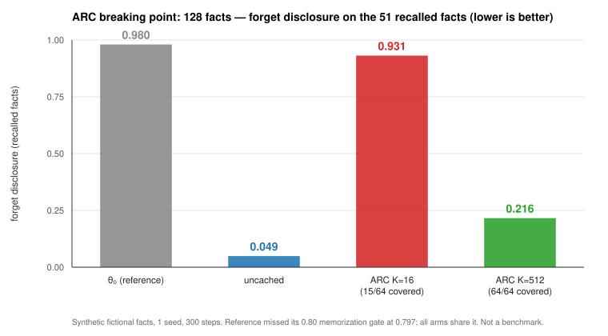

# ARC — Amortized Reference Caching (4-hour sprint, 2026-10-20)

**A proof-driven sprint that disproved its own founding idea in 8 minutes, pivoted, and
ended with a measured 1.26× speedup, a proved negative result, and a metric that reorders
the leaderboard.** All on synthetic data; no published-benchmark comparison attempted.

> ### ⚠ AMENDED — ARC's efficacy parity does **not** scale
>
> [`outputs/AMENDMENT_01_breaking_point.md`](outputs/AMENDMENT_01_breaking_point.md) reports a
> later **128-fact** probe that breaks ARC. With an under-covering pool (`K=16`, 15 of 64
> forget facts represented) ARC **does not forget at all** — disclosure **0.931** against the
> uncached control's **0.049**, on facts the reference recalled at 0.980. With full coverage
> (`K=512`) it leaves **0.216** vs **0.049**: 4.4× more residual disclosure. The **cost**
> results below — exactness, forward counts, 1.257× speedup — are unaffected; the
> **matched-efficacy** claim is now scoped to 24 facts. A sharp per-fact prediction
> pre-registered in `scripts/build_big.py` was also **refuted as stated**.
>
> 

| Outcome | Status |
|---|---|
| Original idea (SPEX: drop the reference pass by algebra) | ❌ **DISPROVED** at 0:08 by its own verifier (10/13 claims) |
| Negative result: reference pass is **not** removable by algebra | ✅ **PROVED** (Prop 5) |
| ARC: remove it by **amortisation** instead | ⚠️ **1.26× faster/step, 18.8–75× fewer reference forwards, targets bit-identical — but efficacy parity holds only at 24 facts; see amendment** |
| ARC's validity boundary (128 facts) | ❌ **FAILS** — under-covering pool discloses 0.931 vs control 0.049 |
| Pre-registered parity verdict | `EFFICIENCY-ONLY` (speedup met; 1 of 3 seeds outside a two-sided band, in ARC's favour) |
| New metric: **clean forgetting** | ✅ exposes that the two arms scoring disclosure **0.000** do so by emitting nothing |

## The three results

**1. You cannot drop the reference pass by algebra (proved).** The exclusion target's
gradient is rank-2 in distribution space, but the *logit* update it induces is ∝ `p(v)`,
so it **does** reshape the non-fact distribution. Proposition 5: the only exactly
shape-preserving edit is a token-level bias on the fact set — i.e. token banning, which the
prior pinned study measured as carrying 91–96 % of collateral damage. So an anchor is
**forced**, which explains why MDU, EMDU, SSD and FX-Mix all carry one.

**2. You can amortise it (measured).** The frozen reference's target is a pure function of
the state, so caching it over a pre-sampled pool is **bit-identical** (`max|Δ| = 0.000e+00`,
gated in every run) and drops per-step forwards 3 → 2.

| | s/step | reference forwards | disclosure ↓ | retain ↑ | clean forgetting ↑ |
|---|---|---|---|---|---|
| uncached, 150 steps | 0.484 | **150** | 0.125 | 1.000 | 0.875 |
| **ARC K=64, 150 steps** | **0.391** | **8** | 0.125 | 1.000 | 0.875 |
| uncached, 600 steps | 0.465 | **600** | 0.188 | 1.000 | 0.812 |
| **ARC K=64, 600 steps** | **0.395** | **8** | **0.125** | 1.000 | **0.875** |

No pool overfitting appeared even at 600 steps (9.4× more reuse). The advantage *grows*
with run length because ARC's reference cost is independent of step count.

**3. Clean forgetting reorders the leaderboard.** Fraction of forget probes that are both
non-degenerate **and** non-disclosing:

| arm @150 | disclosure ↓ | empty | **clean forgetting ↑** |
|---|---|---|---|
| MDU τ=1 | **0.000** | 15/16 | **0.000** |
| EMDU | **0.000** | 16/16 | **0.000** |
| NPO | 0.500 | 0 (12 repetitive) | 0.250 |
| SC-TF | 0.125 | 0 | **0.875** |
| **ARC K=64** | 0.125 | 0 | **0.875** |

Every arm scoring a perfect 0.000 achieves it by **emitting nothing**. Quoting those
numbers without the empty-rate misrepresents them.

## Not claimed

Certified deletion · benchmark superiority · novelty (caching a frozen teacher is standard
in distillation; ARC's content is the observation that this family's per-step reference is
amortisable, plus the measurement) · transfer beyond 24 synthetic facts, one model, one
decoder.

## Contents

| Path | What |
|---|---|
| [`theory/THEORY.md`](theory/THEORY.md) | All statements and proofs, **including the disproof and both wrong derivations, preserved not overwritten** |
| [`scripts/verify_theory.py`](scripts/verify_theory.py) | Symbolic (sympy) + numeric (float64, 300 instances) check of every claim; exits nonzero on failure |
| [`outputs/FINAL_REPORT.md`](outputs/FINAL_REPORT.md) | Full report, errors section included |
| [`outputs/RESULTS.md`](outputs/RESULTS.md) | Cost + efficacy + parity tables |
| `outputs/clean_forgetting.json` · `long_run_comparison.json` · `theory_verification.json` | Metric records |
| `outputs/eval_generations_dedup.json` | **1,104 unique generations**, 23 checkpoints |
| `outputs/baselines/` | NPO, MDU τ=1, EMDU, SC-TF training histories + measured cost |
| [`figures/clean_forgetting_vs_retention.svg`](figures/clean_forgetting_vs_retention.svg) | Plot |
| `scripts/arc.py` | ARC + uncached control (pinned losses imported unmodified) |
| `ATTEMPTS.tsv` · `logs/` | Every attempt, failures charged and logged |

Pins: LLaDA-8B-Instruct `08b83a6feb34df1a6011b80c3c00c7563e963b07` (reused read-only);
exclusion target and SFT loss from `bijay299/XXResearch@b01bcbb4d3026ecc21da3e4050504059934ee6fb`,
imported byte-identically.
