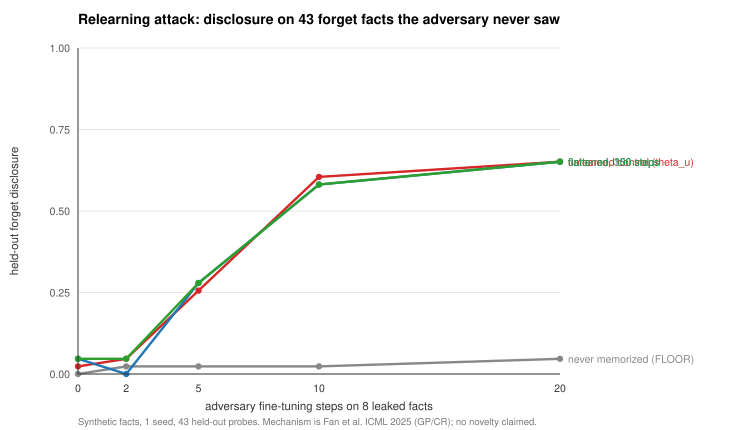

# Relearning robustness for masked-diffusion unlearning (2026-10-20)

**A fresh sprint that measured a vulnerability nobody had measured, refuted its own
hypothesis about the cause, and then showed that the published defense for it does not
transfer.** Synthetic data; GPUs 2–3 of a shared host; no benchmark comparison attempted.

| Outcome | Status |
|---|---|
| Masked-diffusion unlearning vulnerable to relearning? | ✅ **YES, measured** — 0.049 → **0.605** on 43 unseen forget facts in 10 adversary steps (floor 0.023) |
| Is θ_u fragile to undirected perturbation? | ❌ **NO — my own hypothesis refuted.** 2× the unlearning edit's norm in random noise leaves disclosure at 0.031 |
| Does the gradient-norm penalty reduce ‖∇L_mem‖ on the MDLM objective? | ✅ **YES** — −40.2% at unchanged forget loss |
| Does that reduction slow the attack? | ❌ **NO** — Δ = −0.023 at k=10 (one probe in 43); pre-registered bar −0.20 → **NOT SUPPORTED** |

**No novelty claim.** The penalty is Fan et al., ICML 2025 (variant GP/CR); the protocol is
Deeb & Roger's RTT. The literature check that established this ran *in parallel with the
first experiment, before the method was built* — see [`RELATED_WORK.md`](RELATED_WORK.md).

## The three results

**1. The vulnerability (new).** MDU and EMDU are the only masked-diffusion unlearning
papers and neither tests robustness. Hand an adversary **8 of 64 forget facts**, let it
fine-tune, and measure the **43 held-out facts it never saw**. The facts are independent
fictional bindings, so the leaked 8 carry no information about the held-out 43 — any
recovery is residual knowledge unlocked.

| adversary steps | θ_u (unlearned) | never-memorized floor |
|---|---|---|
| 0 | 0.023 | 0.000 |
| 5 | 0.256 | 0.023 |
| **10** | **0.605** | **0.023** |
| 20 | 0.651 | 0.046 |

The floor earns its place: it *does* learn the 8 facts it is given (0.000 → 0.875) while its
held-out disclosure stays flat. **Low single-shot disclosure is not evidence of removal.**

**2. The cause is directional, not positional.** Random perturbation scaled to multiples of
the real unlearning edit (‖ΔW‖_F = 11.586) does nothing — disclosure stays 0.031 even at
**2×** — while the same perturbation leaves a *present* fact at 1.000. This **refutes the
fragility hypothesis I had formed** and invalidates the robustness-*radius* framing in my
own Proposition 2. Recovery needs gradient information about the forget set.

**3. The defense transfers as a mechanism, not as a defense.**

| | ‖∇L_mem‖ | forget loss | disclosure at k=10 |
|---|---|---|---|
| θ_u | 1.1547 | 0.9188 | 0.605 |
| flattened 300 steps | **0.6941 (−39.9%)** | 0.9195 (+0.0007) | **0.581** |
| flattened, λ_G=10 | 0.6902 (−40.2%) | 0.9204 | not run (same state) |

A 40% reduction in the penalised quantity bought **one probe out of 43**. Both flattened
arms converge exactly onto the control at k=20 (0.651). Retain identical throughout, so
nothing hides in output collapse. A direct empirical instance of Song et al.'s
*"Measure, Don't Optimize"* objection, on the objective where it was untested.



## What this does not license

**Not a refutation of Fan et al.** — they report GP working for autoregressive LLMs on
WMDP/MUSE; this is one variant, one seed, synthetic data, on a different objective.
`ρ` was never swept, the exact-HVP route untried, and the **`λ_G` sweep is confounded**: the
gradient clip at norm 1.0 normalises `λ_G`'s scale away, so 10× `λ_G` changed the achieved
reduction by 0.6%. The honest scope is *"over the 0 → 40% reduction actually achieved, no
gain."* The reference model also missed its own 0.80 memorization gate at 0.797, so metrics
are restricted to the 51 recalled facts and absolute numbers are indicative.

## Four errors, each of which looked like a result first

Recorded in [`outputs/FINAL_REPORT.md`](outputs/FINAL_REPORT.md) §7:

1. **AdamW made a provable no-op move** — per-coordinate normalisation turns a zero
   gradient into a step of ≈lr, so the λ_G=0 control random-walked off θ_u. Under SGD it is
   bit-identically stationary (‖∇L_mem‖ = 1.154713 at steps 0, 5 and 9).
2. **The guard compared incomparable quantities** and aborted all three arms at step 10 —
   including the one that cannot move. With `t ~ U(0,1)` the per-step `L_mem` swings
   0.37 → 2.21 with no drift. **Those "guard fired" results were artefacts**, not the
   confirmation of P3a they resembled.
3. **A step-size failure masqueraded as a dead mechanism** — the first hyperparameters moved
   parameters 0.07% of the relevant scale.
4. **My Proposition 3 drift test asserted the wrong variable** (large `λ_G`); the real
   dependence is the starting *basin*. The wrong version is preserved in
   [`theory/THEORY.md`](theory/THEORY.md) beside its correction.

## Theory

11/11 machine-checked claims (`scripts/verify_theory.py`, sympy + float64 over random
instances). Two findings constrained the design *before* any GPU time:

- **P3a** — the penalty is also satisfied at the memorized minimum, and from inside that
  basin it drives the fact fully back (`L → 0.0000`). So it can only ever be a **second
  stage**, never applied from θ₀.
- **P3b** — high loss and zero gradient coincide only in 1-D; raw ascent diverges in 40
  dimensions. So the first term must be an **anchor**, not ascent.

## Next step worth taking

Not another defense. Measure the cosine similarity between the adversary's recovery
direction and the original unlearning edit, as a function of `k`. If recovery runs
anti-parallel to the edit, **the edit's own direction is the leak** — a mechanism no
flattening penalty can reach.

## Layout

```
PLAN.md            pre-registered plan, gates and verdict rules (written before Phase 0)
RELATED_WORK.md    literature check; what is already published and what this cannot claim
theory/THEORY.md   L1, P2, P3a, P3b, P4 with wrong derivations preserved
scripts/           probe, method, noise probe, theory verifier, analysis, ledger
outputs/           report, tables, curves, per-run reports, all generations
ATTEMPTS.tsv       every attempt including failures, with measured GPU/CPU
```
